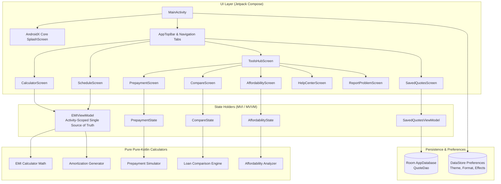

# EMIverse — Premium Loan & Financial Intelligence Suite

EMIverse is an ultra-modern, production-grade Android financial utility engineered with **100% Jetpack Compose**, **Kotlin Coroutines & Flow**, **Room Persistence**, and a custom **Cosmic Glassmorphic Design System**. It goes beyond standard loan calculators by providing multi-scenario prepayment modeling, loan comparison with dual winner badges, debt-to-income affordability intelligence, paginated vector PDF amortization export, and hardware-aware adaptive motion budgeting.

---

## 🌟 Key Features

1. **Calculate Screen (Precision EMI Engine)**
   - **Real-Time Reducing Balance EMI Math**: Computes exact monthly payments, total interest, and total payable amount with zero floating-point drift.
   - **Interactive Donut Breakdown**: Animated dual-tone ring illustrating Principal vs. Interest percentage ratio with integrated TalkBack semantics.
   - **Quantum Sliders & Tactile Chips**: Smooth continuous value scrubbing paired with quick-select presets for Home, Personal, Vehicle, and Education loans.
   - **Dual Number System**: Instant toggle between Indian Numbering (Lakhs/Crores — `₹XX,XX,XXX`) and International Standards (Millions/Billions — `₹XXX,XXX.XX`) with live cursor-mapped text field transformations.
   - **"See the Math" Visual Breakdown**: Explanatory bottom sheet detailing reducing balance amortization step-by-step.

2. **Amortization Schedule & PDF Export**
   - **Interactive Area Chart**: Visualizes closing balance trajectory over the entire loan lifecycle with touch-scrub month inspection.
   - **Yearly & Monthly Breakdown**: Paginated amortization breakdown table separating principal repayment, interest accrued, and remaining balance.
   - **Off-Thread Vector PDF Generation**: Generates clean, multi-page A4 PDF documents with bundled typefaces, verified Rupee glyph rendering, and one-tap Android Share sheet dispatch.

3. **Prepayment Simulator (Accelerated Debt Payoff)**
   - **4 Prepayment Modalities**:
     - *One-time Lumpsum*: Pay extra in a specific target month.
     - *Monthly Recurring*: Fixed extra principal paid alongside each monthly EMI.
     - *Yearly Recurring*: Annual principal prepayment lump sum.
     - *Yearly Step-Up*: Annual percentage increase in payment obligations.
   - **Flexible Step-Up Engine**: Select whether yearly step-up applies to *Extra payment only* or the *Whole EMI*, backed by a live comparison chart showing interest saved and months cut.

4. **Loan Comparison Matrix**
   - **Side-by-Side Evaluation**: Compare Loan A vs. Loan B with varying principal, interest rates, tenures, and processing fees.
   - **Dual Winner Badges**: Accurately differentiates the **"Lowest Monthly EMI"** winner from the **"Lowest Overall Cost"** winner (accounting for upfront processing fees).
   - **One-Tap Swap**: Instantly swap parameters between Loan A and Loan B with zero loss of state.

5. **Affordability & Debt-to-Income (DTI) Analyzer**
   - **Total Obligation Ratio Gauge**: Real-time needle gauge showing debt-to-income percentage across three safety zones:
     - 🟢 *Comfortable* ($\le 30\%$)
     - 🔵 *Moderate* ($30\% - 40\%$)
     - 🔴 *Stretch* ($> 40\%$)
   - **Borrowing Power Estimation**: Calculates maximum recommended loan principal and affordable EMI given monthly net income and existing liabilities.

6. **Saved Quotes (Room Database)**
   - **Input-Only Canonical Storage**: Stores clean loan inputs (Principal, Rate, Tenure in Months, Category, Fee %, Pinned state, Timestamp); computed results are evaluated dynamically via pure calculators to guarantee mathematical consistency.
   - **Favorites & Sorting**: Pin quotes to the top of the list, rename, delete, or restore directly into the primary calculator with a single tap.
   - **Migration-Ready Architecture**: Schema export enabled (`exportSchema = true`) with strict versioning.

7. **Help Center & Diagnostic Reporting**
   - **Searchable FAQ Accordion**: Interactive questions covering amortization mathematics, prepayment calculations, DTI boundaries, and number systems.
   - **Report a Problem**: In-app feedback portal with screenshot attachments, issue categorization, and automatic compilation of non-PII diagnostic metadata (Device model, OS build, memory class, effects level).

8. **Cosmic UI & Adaptive FX System (Uiverse-Inspired Native FX)**
   - **Custom Components**: `SweepBorderCard`, `ShineButton`, `GlowPillSwitch`, `OdometerText`, `PopTooltip`, `TiltCard`, `PathCheckmark`, and `ShimmerBox`.
   - **Strict Animation Budgeting**:
     - 🚀 **Full**: Up to 4 concurrent infinite transitions with ambient galactic background.
     - ⚖️ **Balanced**: Up to 2 concurrent transitions, reduced particle complexity.
     - 🍃 **Lite**: 0 infinite animations; all elements remain purely static for low-RAM devices or battery saver modes.
   - **Android 12+ Splash API**: Integrated `androidx.core:core-splashscreen` with `#0D092E` cosmic branding, zero launch flash, and condition-held DataStore preference resolution.

---

## 🏗️ Architecture & Data Flow

EMIverse adheres strictly to modern Android Architecture with **Unidirectional Data Flow (UDF)**:



---

## 🧮 Mathematical Formulas Implemented

### 1. Equated Monthly Installment (EMI) — Reducing Balance
The standard monthly installment is derived from the annuity formula:

$$EMI = P \times r \times \frac{(1 + r)^n}{(1 + r)^n - 1}$$

Where:
- $P$ = Loan Principal Amount
- $r$ = Monthly Interest Rate $= \frac{\text{Annual Interest Rate}}{12 \times 100}$
- $n$ = Loan Tenure in Months

*Total Payable* = $EMI \times n$  
*Total Interest* = $\text{Total Payable} - P$

### 2. Monthly Amortization Schedule
For month $k \in [1, n]$:
- $\text{Interest}_k = \text{Opening Balance}_k \times r$
- $\text{Principal}_k = EMI - \text{Interest}_k$
- $\text{Closing Balance}_k = \text{Opening Balance}_k - \text{Principal}_k$

### 3. Prepayment & Step-Up Calculations
Let $E$ be the base extra prepayment per month and $s$ be the yearly step-up percentage ($s = \frac{\text{Step \%}}{100}$). In loan year $y = \lfloor\frac{k - 1}{12}\rfloor + 1$:

- **Extra Payment Step-Up Mode**:
  $$\text{Payment}_k = EMI + E \times (1 + s)^{y - 1}$$
- **Whole EMI Step-Up Mode**:
  $$\text{Payment}_k = (EMI + E) \times (1 + s)^{y - 1}$$

The loan terminates as soon as $\text{Closing Balance}_k \le 0$, yielding total interest saved and reduction in tenure.

### 4. Affordability & Debt-to-Income (DTI)
Given Gross Monthly Income $I$, existing monthly loan obligations $O_{exist}$, and Maximum Allowable DTI Ratio $R_{max}$ ($20\% - 60\%$):

$$\text{Max Allowable Total EMI} = I \times R_{max}$$
$$\text{Max New Loan EMI} = \max(0, \text{Max Allowable Total EMI} - O_{exist})$$
$$\text{Max Borrowing Capacity} = \text{Max New Loan EMI} \times \frac{(1 + r)^n - 1}{r \times (1 + r)^n}$$
$$\text{Total Obligation Ratio (DTI)} = \frac{O_{exist} + \text{Proposed EMI}}{I} \times 100\%$$

---

## 🛠️ Tech Stack & Dependencies

| Component | Library / Framework | Version |
|---|---|---|
| **Language** | Kotlin | `2.0.21` |
| **Build Tool** | Android Gradle Plugin (AGP) | `9.3.3` |
| **Minimum SDK** | Android 8.0 (API 26, Oreo) | `26` |
| **Target SDK** | Android 15 (Vanilla Ice Cream / API 37) | `37` |
| **UI Framework** | Jetpack Compose (Compose Compiler 2.0.21) | BoM `2024.10.01` |
| **Design System** | Material 3 (`androidx.compose.material3`) | BoM `2024.10.01` |
| **Splash Screen** | AndroidX Core SplashScreen | `1.0.1` |
| **Navigation** | Navigation Compose | `2.8.4` |
| **Local Persistence** | AndroidX Room (Runtime, KTX, KSP Compiler) | `2.6.1` |
| **Preferences** | AndroidX DataStore Preferences | `1.1.1` |
| **Async & Flow** | Kotlin Coroutines & Flow | `1.9.0` |
| **Lifecycle** | Lifecycle ViewModel & Runtime Compose | `2.8.7` |
| **Testing** | JUnit 4, Kotlin Coroutines Test, Room Test | `4.13.2` / `1.9.0` |

---

## 🚀 Building & Testing

### 1. Prerequisites
- Android Studio Ladybug | 2024.2+ or Android Studio Meerkat
- JDK 17 or JDK 21 configured in `JAVA_HOME`
- Android SDK Platform 35 / 36+

### 2. Gradle Commands
```bash
# Run all 64 unit tests across calculation models, viewmodels, and insights
./gradlew testDebugUnitTest

# Run complete Android lint verification (0 errors)
./gradlew lintDebug

# Assemble Debug APK (outputs to app/build/outputs/apk/debug/app-debug.apk)
./gradlew assembleDebug

# Assemble Release APK (outputs to app/build/outputs/apk/release/app-release.apk)
./gradlew assembleRelease
```

### 3. Test Coverage Summary
- **Total Unit Tests**: **64 passing** (0 failures, 0 skipped, 0 errors).
- **Suites**:
  - `EMIViewModelTest`: Core formula verification, slider changes, tenure conversion, Indian/Western formatting.
  - `AffordabilityCalculatorTest`: DTI ratio calculations, zone boundaries, zero-income safety checks.
  - `PrepaymentSimulatorTest`: Lumpsum, monthly recurring, yearly recurring, step-up (Whole EMI vs Extra).
  - `CompareLoanTest`: Dual winner evaluations (lowest EMI vs lowest overall cost including fees).
  - `InsightsTest`: Automated financial recommendations based on loan interest-to-principal ratios.
  - `ReportAndFaqTest`: Search indexer, accordion filtering, diagnostic payload formatting.
  - `SavedQuoteTest`: Entity mapping, dynamic EMI derivation from persisted inputs.
  - `AnimationUpgradeTest`: Effects level budget verification (Full $\le 4$, Balanced $\le 2$, Lite $= 0$).
- *Note*: Room DAO instrumented tests (`QuoteDaoTest`) are located in `app/src/androidTest` for automated execution on connected physical devices or Android emulators.

---

## 📱 Accessibility & Motion Guidelines

- **Screen Readers (TalkBack)**: Every interactive icon, gauge, donut chart, comparison curve, and segmented pill includes explicit semantic descriptions (`contentDescription`, `role = Role.RadioButton`).
- **Font Scaling**: All text containers and layout cards gracefully accommodate up to `1.3x` font scale without truncation.
- **Hardware-Aware Adaptive Motion**: On devices with limited RAM (`ActivityManager.isLowRamDevice`) or when the user activates battery saver, the app automatically initializes in **Lite Mode** (0 infinite loops, static gradients) to preserve frame rates and battery health.

---

## 📄 License & Credits
Developed as an advanced academic and professional portfolio project showcasing state-of-the-art Android Jetpack Compose architecture and financial calculation algorithms. All rights reserved.
